# Itt a Storage Explorer 0.6.0!

Végre-valahára, több mint egy teljes év eltelte után ismét eljött a nap (este), hogy új release
szülessen az Explorerből. Az év során sokminden elkészült, és a legtöbb ~~áldozat~~ kolléga már
találkozhatott is a fejlesztésekkel - SharePointon elérhetőek is voltak különböző provizorikus
release-ek. A hosszú hétvégén sikerült nekifeküdni, és elkészült minden, amit ebbe a verzióba
akartam beszuszakolni (attól most tekintsünk el, hogy eredeti terveim szerint a kódzár folyó év
márciusa lett volna).

TL;DR Az új verzió binárisai és a changelogok
elérhetőek [a GitHub release page-n](https://github.com/szabolcs-bazil-papp/storage-explorer/releases/tag/v0.6.0),
a szokásos formátumban:

- CLI alkalmazás JAR-ként
- Swing alkalmazás JAR-ként és Windowsos telepítőállományként
- A spring-boot-starter
  elérhető [Maven Central-on](https://central.sonatype.com/artifact/com.aestallon.storageexplorer/storageexplorer-spring-boot-starter/overview),
  az aktuális Gradle-be írandó koordináta:
  `implementation 'com.aestallon.storageexplorer:storageexplorer-spring-boot-starter:0.6.0'`

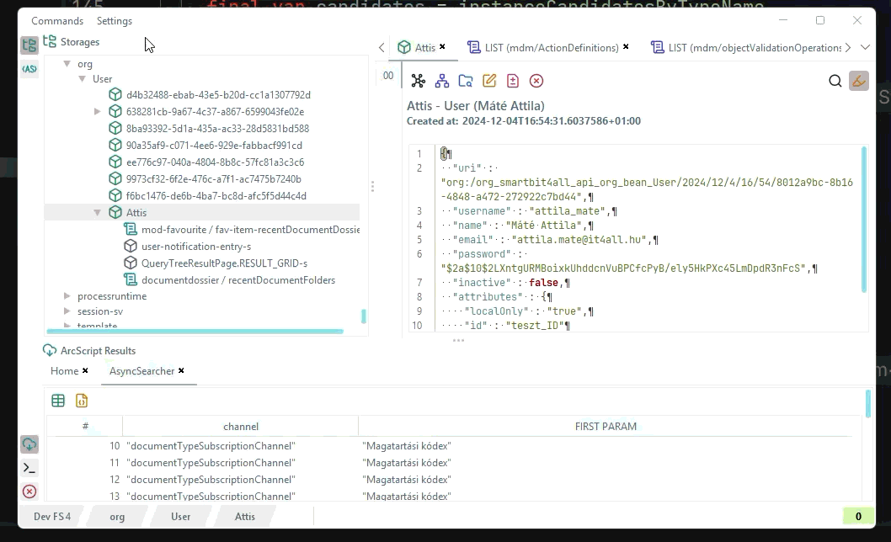

És akkor most következzen a feature-eső:

## ArcScript: új képességek, szintaktikus cukorkák

- a típus-, séma-megadás és az arc-ok mostantól idézőjel nélkül is írhatók, mint valami tisztességes
  nyelvben
- új `yield` blokkal adhatók meg a visszaadni kívánt oszlopok (a régi `show` parancs
  deprecated lett);
- megérkezett az `order by` rendezés, valamint a hiányzó `lesser_than`, `greater_than` és
  `between <val1> and <val2>` operátorok;
- `pragma VERBOSE` paranccsal részletes futási információ kérhető, tehát aki szeretné minden query
  után külön nézegetni, hogy milyen frankó gyors a progi, annak mostantól ezt explicit kérnie kell
- bővült és pontosabb lett a szintaxiskiemelés;
- stringekre érkezett egy `matches` operátor, ahol tetszőleges regex-szel lehet szűrni (a lusta
  ember LIKE-ja)
- implementálásra kerültek a `time` típus műveletei - itt ISO formátumban adható meg LocalDate,
  LocalDateTime, OffsetDateTime vagy ZonedDateTime sima string-ként, de az engine dátumként dolgozik
  mind a megadott, mind a talált értékekkel. Ide készült négy time-specifikus operátor:
  `in_the_year_of`, `in_the_month_of`, `in_the_day_of` és `in_the_hour_of`, hogy az ilyen
  "saccperkábé tegnap délután egykor milyen dossziék jöttek létre" típusú query-ket egyszerűbb
  legyen írni.

Példaként álljon itt egy állatorvosi ló:

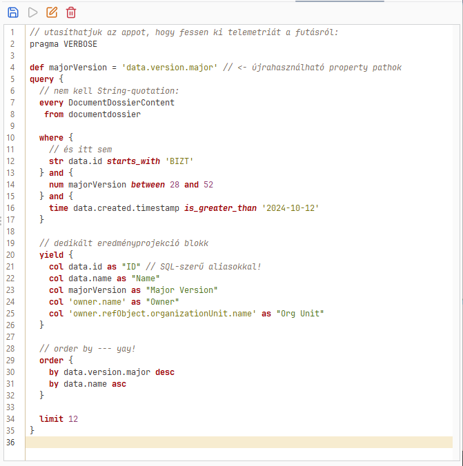

A még jobb hír, hogy a teljes működésről gyorstalpaló és szintaxisösszefoglaló elérhető
a [Wiki-n](https://github.com/szabolcs-bazil-papp/storage-explorer/wiki/ArcScript)!

## ArcScript: Alternatív engine

Az ArcScript nagy hiányossága, hogy mivel kliensoldalon fut, ezért optimális működéséhez körülbelül
a világ összes memóriájára és processzoridejére szüksége van, ez pedig sajnos nem minden
élethelyzetben elérhető. :(

Erre a megoldás a mostani release-ben - dobpergés - sem érkezett meg.

Viszont készült egy egész rendesen testreszabható alternatív engine, ami visszafogottabb
lekérdezések során paritásban van a "legacy" engine-nel, combosabb query-k esetén pedig lassúsággal
ellensúlyozza a `java.lang.OutOfMemoryError` életérzésének hiányát. Ahhoz persze, hogy ezt megtegye,
egyelőre erősen testre kell szabni a végrehajtandó query minőségétől függően (amit jobb esetben a
felhasználó már előre sejt).

Erre a célra elérhető a _Beállítások_ menüben egy szemrevaló menüpont:

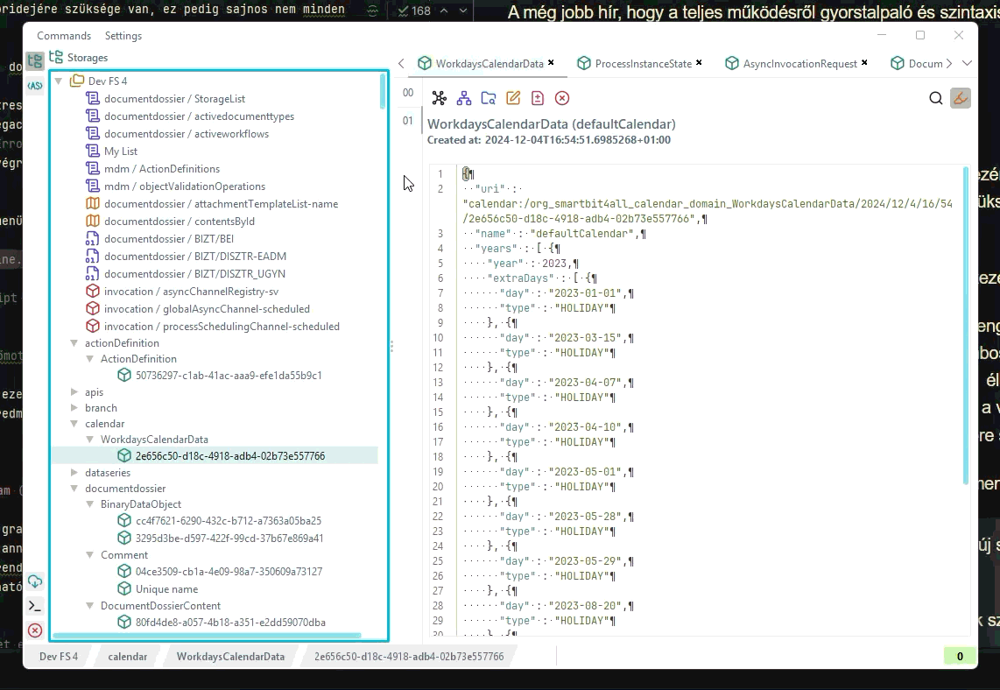

Mint a mellékelt ábra is mutatja, a program megkísérli az _öndokumentáció_ hiú ábrándjának
lehetetlenségét, és tooltipekkel igyekszik magyarázni, hogy melyik beállítás mit csinál.

A default működés egyelőre a LEGACY engine; de nagy szeretettel várok mindenféle visszajelzést, ha
valaki kipróbálná, hogy mit süt a kis szűcs.

Természetesen az ArcScript változások a CLI alkalmazásra is érvényesek - ott azonban a kedves
felhasználónak kézzel kell megírnia a beállításokat biztosító JSON fájlt.

## Három speciális állat speciális kezelése

### Unscoped StoredReference

A néhai 0.5.0-ös verzióban az Explorer nagyívűen eltekintett attól a ténytől, hogy vannak scope
nélküli `StoredReference`-ek a storage-ban. Ugyan ezt a hiányosságot már hónapokkal korábban
orvosoltam, így a buzgó felhasználó már bizonyára szembesült vele, hogy márpedig ez így októberben
finoman szólva sem nevezhető "új feature"-nek, mégis szeretném mindenki szíves figyelmébe ajánlani.

Az Explorer az adott storage alatt közvetlenül, piros dobozokkal tünteti fel őket:

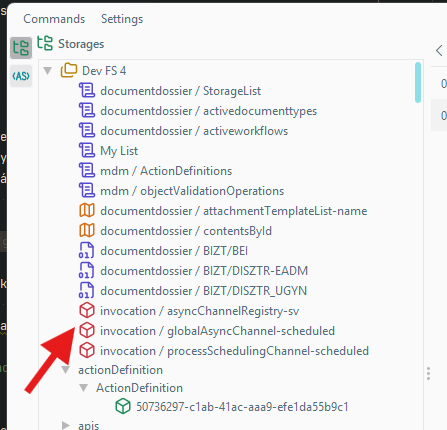

Érdemes ezekre az objektumokra figyelni, mert a deadlockok melegágya. Tapasztalatom szerint csak a
platform és egy-két nagyon körülbástyázott modul tesz le ilyeneket. Ha valaki ehhez a tárolási
formátumhoz fordulna, azt javaslom, hogy kerülje. Ha pedig muszáj velük dolgozni, akkor most már az
Explorerben is látszódnak. Hurrá.

### ObjectReferenceById

Ez az állatfaj tárolásilag nem különleges, de logikai értelmében igen. Funkciója, hogy egy sémán
belül egy tetszőleges string-et (sémában értelmezve) egyedi azonosítóként tároljon, és rámutasson
egy az azonosított objektum URI-jára.

Az új verzióban ezek az objektumot egyedi ikont és betekintőt kaptak, ahonnan a hivatkozott
objektumra lehet ugrani:

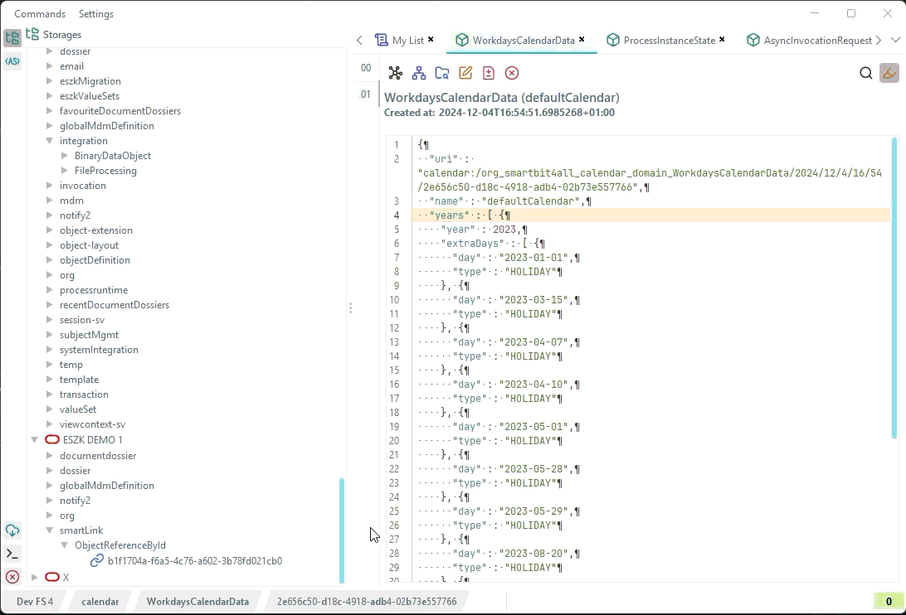

### BinaryData (Object)

A StorageExplorer eddigi hiányossága volt, hogy nem volt hajlandó `BinaryDataObject`-et betölteni.
StorageSQL-ben ez nem volt különösebben fájdalmas, mert ha már megvolt az `URI`, akkor (pl.
DBeaver-rel) egyszerűen hozzá lehetett férni a fájlállományhoz. FS-en viszont indokolatlanul
nehézkes volt ugyanez a művelet.

Mostantól BinaryDataObject URI-ra Ctrl+kattintással tetszőleges helyre le lehet menteni az URI
mögött lapuló fájlt:

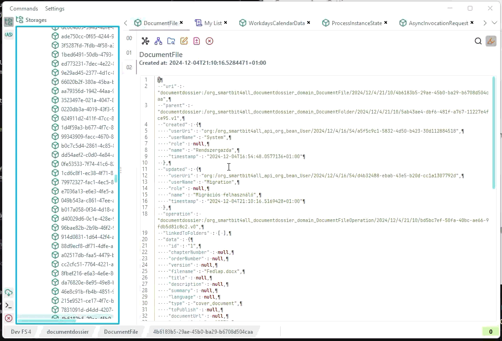

## Entity Relationship Diagram

Készült egy új grafikus nézet: bármely objektum-bejegyzésből kiindulva megrajzolható a hozzá tartozó
típus és annak kapcsolatai (hivatkozásai) egy entitás-kapcsolat diagramon. A diagram force-directed
elrendezéssel jelenik meg, a union és complex típusútulajdonságok pedig kattintásra
kibonthatók/összecsukhatók, így a bonyolultabb, elágazó típusú mezők is áttekinthetők maradnak.

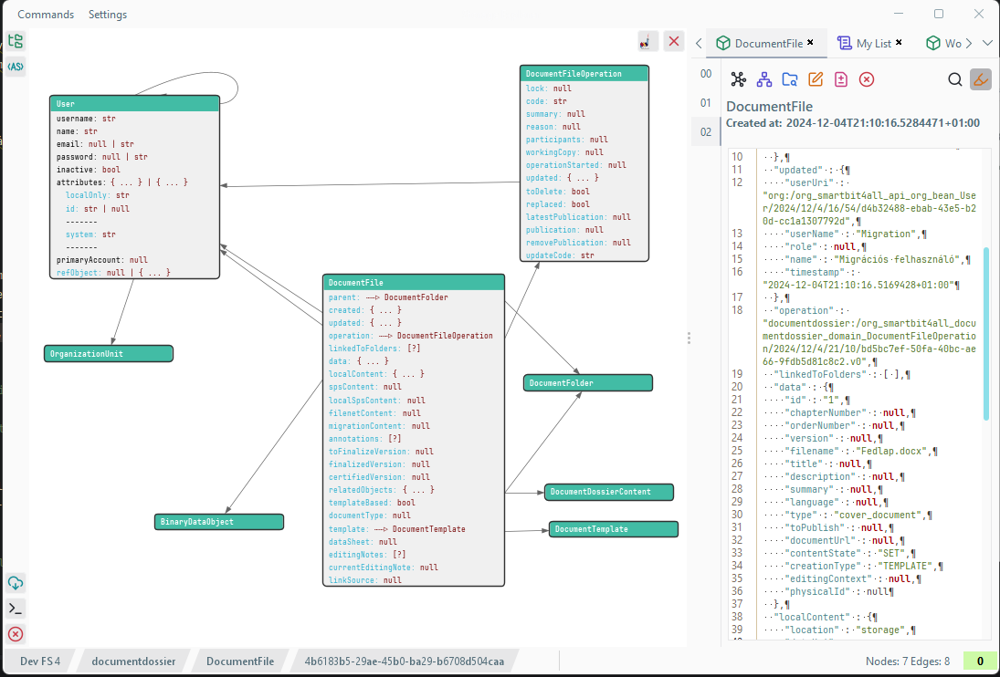

Az alkalmazás a típusinformációkat használat során gyűjti a betöltött objektumok alapján, és az
összemergelt eredményt háttérfolyamatban perzisztálja, hogy _később is jó legyen_.

A felhasználás célja egyrészt, hogy új domainnel lehessen ismerkedni, amelynek alkalmazása már
felbőgött lokálisan. Másrészt szemrevételezéssel történő adatvalidatációra is jó (erről kicsit
bővebben lentebb).

Harmadrészt, a kirajzolt diagram exportálható PlantUML formátumba is, így a dokumentációba, tervekbe
is könnyen átemelhető (egy kis kézi nyesetelés után).

Az exportálás testreszabható: beállítható, hogy a complex típusú tulajdonságok önálló
dataclass-ként jelenjenek-e meg, rajzolódjanak-e ki az élek a tulajdonságokból, illetve látszódjon-e
a kapcsolatok multiplicitása:

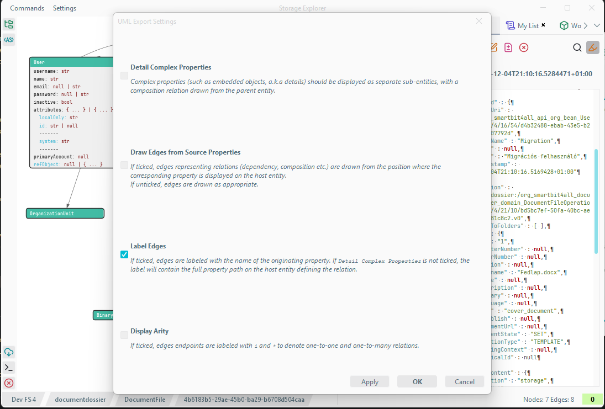

Természetesen az alkalmazás által rajzolt diagram színei világos és sötét módra is testreszabhatóak:

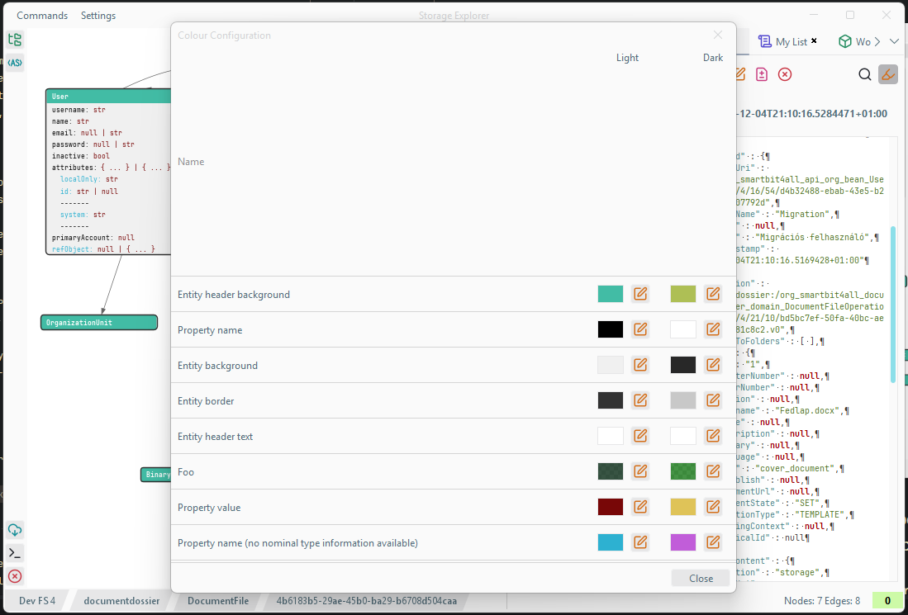

## Összevetés nominális típusokkal

Az ERD nézet mellé egy új funkció is társul: betölthetők a szent YAML leírók, amelyek a
storage-ban tárolt típusok *deklarált* (nominális) alakját írják le. Ezt az alkalmazás összeveti a
storage-ból valóban felderített (strukturális) adatokkal, és a diagramon tooltipben jelzi, hogy egy
adott tulajdonság értéke megfelel-e a deklarált típusnak, vagy eltérés található.

A példa kedvéért:

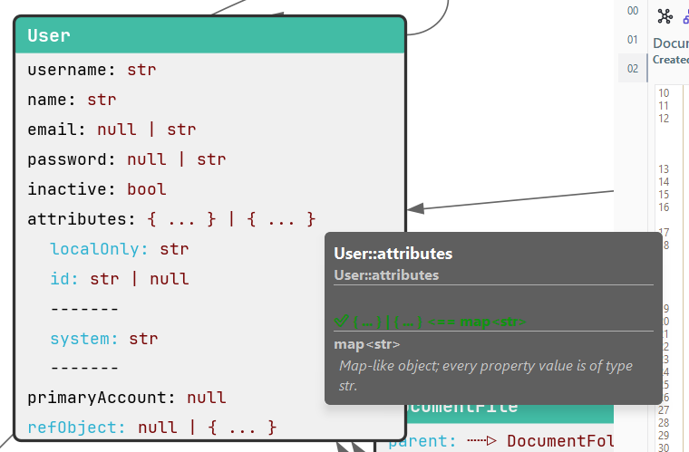

A User bean `attributes` mezőjében ebben a storage-ban diszjunkt objektumuniót tárolunk, de mindkét
variánsnak nagy string típusú property-jei vannak: ez megfelel a YAML-nek, ami string Map-ot ír elő
erre a mezőre.

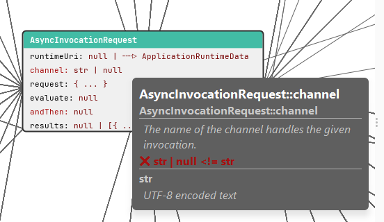

Ellenpéldaként: az AsyncInvocationRequest channel mezője a YAML szerint required string típusú, de a
storage-ban van legalább 1 példány lementve, amelynél ez a property `null`. Történetesen ez az
eltérés a specitől azóta javítva lett, és egyébként sem volt hibaforrás.

Ahogy a fenti példa is mutatja, az ilyenfajta eltérések lehetnek ártalmatlanok, vagy ártalmasak
(köznapi néven: bug). A potenciálisan veszélyes eltérésekre azonban csak az talál rá, aki keres.

## Külcsín

Készült persze egy-két dolog, ami a működést sem nem zavarja, sem javítja. Ilyetén például:

- Egységes, "letisztult" ikonpaletta, ahogy a fenti illusztrációkon is láthatjátok.
- Light/Dark mód, amit megjegyzünk újraindítások között.
- Egy indítóképernyő, ami túl nagy és túl aggresszív, szóval pont illik a szoftverhez.
  
  Ezen nyomon is követhető, hogy az inicializálás során épp melyik lépésnél tartunk. Progress bar
  majd 10 év múlva várható (most eskü végig 99%-nál tartunk).
- Minden fájlválasztó dialógus mostantól natív, nem a Sun Microsystems által megálmodott
  crossplatform borzadmány.
- Került be egy hibanézet és egy naplófájlnézet is, hogy ha valami nemkerek, akkor lehessen
  nyomozgatni, hogy mi nem kerek.

## Nem is annyira külcsín

Elkészült számos bugfix is, melyeknek túlnyomó többségét a kedves kollégák jelentették a hónapok
során. Egyetlen dolgot emelnék itt ki: a betekintőkben mostantól található egy toggle, amellyel
megjeleníthető/elrejthető a whitespace / newline és a rejtett karakterek. Cseles állat a Zero-Width
Whitespace, de mostantól ez is elcsíphető az Explorerrel. A rejtettkarakter-megjelenítés by-default
bekapcsolt állapotban leledzik:

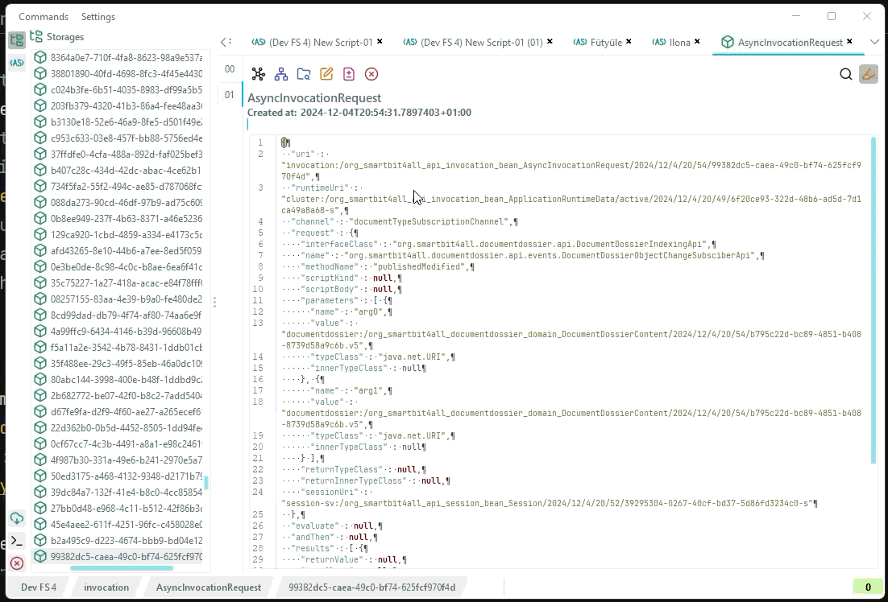

## Végszó

Köszi, hogy végigolvastad, a szokásos kérésekkel búcsúzom:

- virágot az öltözőbe
- bugreportot GitHub-ra
- contribution-ra jelentkezést személyesen

